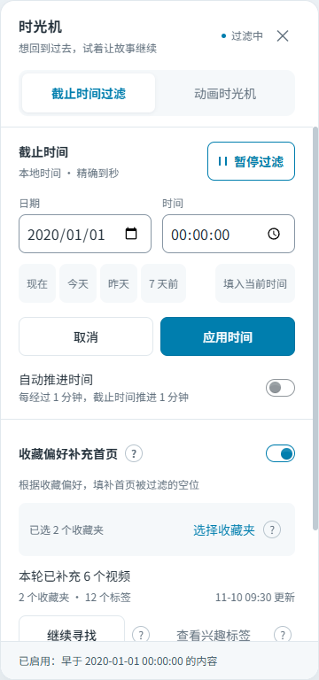
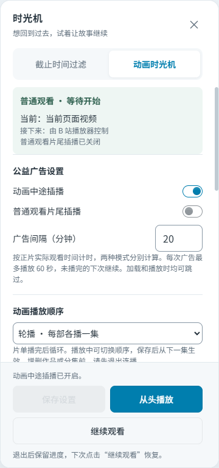
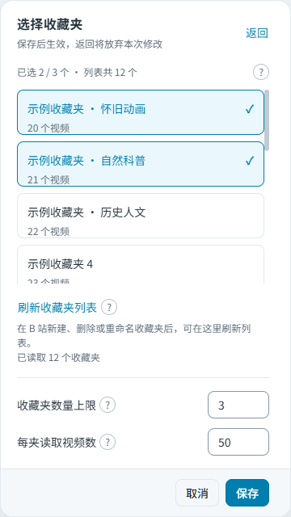

# Bilibili Time Machine

**Browse Bilibili as of a date in the past, or watch your favorite cartoons back to back.**

Bilibili Time Machine filters videos and comments by a cutoff date and plays animated shows from your own playlist. It keeps Bilibili's native pages and player and is available as a Chrome extension or Tampermonkey userscript.

[简体中文](README.md) · [Download extension](https://github.com/LeKZzzz/bilibili-time-machine/releases) · [Install userscript](https://greasyfork.org/en/scripts/601594) · [Report an issue](https://github.com/LeKZzzz/bilibili-time-machine/issues)

## What you can do

| What you want | How it works |
| --- | --- |
| See only content from before a chosen date | Set a cutoff to filter video cards, loaded comments, and XML danmaku; optionally let the cutoff advance with time |
| Watch cartoons like a TV channel | Arrange shows and episodes in Animation Time Machine, alternate between shows or finish one at a time, and resume later |
| Add public-service ad breaks | Choose clips and an interval; animation can pause mid-episode, while ordinary viewing waits until the video ends. Ads are always skippable |
| Leave fewer gaps on the filtered homepage | Use tags from your favorite folders to find videos before the cutoff, filling empty slots without replacing visible content |

**Time filtering and playback are independent.** Watching animation does not require a cutoff or an enabled filter. With filtering enabled, the animation you are watching can still play, while recommendations and comments keep their existing filtering rules.

Animation playback includes a public-service ad break after every **20 minutes** of accumulated viewing by default. You can skip it at any time, or turn off “动画中途插播” (Mid-episode animation ads) and save settings.

The tool uses content still available on Bilibili. It cannot restore historical homepages, deleted videos, or past recommendation rankings, and does not bypass membership or regional restrictions.

[Installation](#installation) · [Watch animation](#watch-animation) · [Ad breaks](#configure-public-service-ads) · [Browse by date](#browse-with-a-date-in-the-past) · [Troubleshooting](#troubleshooting-and-limitations) · [Contributing](#contributing)

> Version scope: this guide describes `v0.4.0`. For an older version, follow its [Release notes](https://github.com/LeKZzzz/bilibili-time-machine/releases). See [Version and compatibility](#version-and-compatibility) for tested and untested scenarios.

<details>
<summary>Preview: time filtering, Animation Time Machine, and favorites</summary>

| Time filtering | Animation Time Machine |
| --- | --- |
|  |  |

| Favorite folders | Interest tags |
| --- | --- |
|  |  |

Screenshots use the `v0.4.0` UI with demo data, not personal favorites. The sample shows illustrate the playlist and can be replaced with your own choices.

</details>

## Installation

**Choose either the extension or the userscript. Do not enable both.** Normal use does not require Node.js or a source build.

### Chrome extension

1. Download `bilibili-time-machine-extension-vX.Y.Z.zip` from **Assets** on [GitHub Releases](https://github.com/LeKZzzz/bilibili-time-machine/releases) and extract it.
2. Open `chrome://extensions`, enable **Developer mode**, and click **Load unpacked**.
3. Select the directory that **directly contains `manifest.json`**, refresh Bilibili, and click “时光机” (Time Machine).

To update, load the new directory, confirm the extension version, and refresh Bilibili. Do not use the Release's **Source code** archives; they are not installable packages.

### Tampermonkey userscript

1. Install and enable [Tampermonkey](https://www.tampermonkey.net/).
2. Open [Bilibili Time Machine on Greasy Fork](https://greasyfork.org/en/scripts/601594), click **Install this script**, and confirm in Tampermonkey.
3. Refresh Bilibili and click “时光机” (Time Machine). You can check for later updates in Tampermonkey.

**Animation and ad features require `v0.3.0` or later.** Greasy Fork and GitHub are published separately, so their versions may differ. If Greasy Fork has not been updated yet, download `bilibili-time-machine.user.js` from a GitHub Release and import it into Tampermonkey. The extracted `bilibili-time-machine-userscript-vX.Y.Z.zip` contains the same script.

## Watch animation

Open **“时光机” (Time Machine)** and select the **“动画时光机” (Animation Time Machine)** tab at the top. The adjacent **“截止时间过滤” (Time filtering)** tab switches back to date settings. The interface is in Chinese; the instructions below include the actual control labels.

1. Try the built-in playlist, or click “添加作品” (Add show), paste a Bilibili video or bangumi link, and click “获取分集” (Find episodes). Select the episodes you want and confirm. To add just one video, you can enter its name and link and add it directly.
2. Choose “轮播 · 每部各播一集” (Round-robin: one episode per show) or “顺播 · 看完一部再下一部” (Sequential: finish one show first). Click “保存设置” (Save settings), then “从头播放” (Start from the beginning).
3. Click “暂停” (Pause) for a break, or “退出连播” (Exit continuous playback) to end the session and retain progress. Next time, open the Animation Time Machine tab and click “继续观看” (Resume).

Click a show to view its episodes or use “添加分集” (Add episodes) to add more. Each show needs at least one episode. Click “保存设置” (Save settings) after adding or removing content.

“继续观看” (Resume) continues from the episode and viewing position on the current page if that episode is in your playlist. Otherwise, it restores your saved progress. “从头播放” (Start from the beginning) starts the first episode in the playlist from the beginning.

The default playlist contains **31 animated shows**, including Chinese classics and international favorites such as Digimon, The Smurfs, and The Little Mole. Episode counts depend on the available sources; complete series are not guaranteed.

<details>
<summary>Playback order, resume, and episode management</summary>

For a show A with two episodes and a show B with three:

| Order | Example |
| --- | --- |
| Round-robin | A1 → B1 → A2 → B2 → B3 → A1 in the next round |
| Sequential | A1 → A2 → B1 → B2 → B3 → A1 in the next round |

The playlist loops after every episode has played. You can switch between round-robin and sequential order during playback and save. The current episode continues without resetting its position or the ad timer; the next episode follows the new order. Saving an order change while paused or during an ad does not resume playback or skip the ad. Exit continuous playback before adding or removing shows or episodes.

After reloading, reopening the browser, or opening a new tab, click “继续观看” (Resume) to continue. A saved episode that has not started playing keeps its saved position; a newly selected episode that has not loaded starts from the beginning.

During continuous playback, manually selecting another episode in your playlist continues the session from that episode and position. This works for same-page changes and navigation within the current window, without clicking Resume again. Selecting a video outside your playlist ends the session. Explicitly exiting does not restart it automatically.

When adding a show or episodes, you can find parts of a video, videos in a collection, or regular episodes from a bangumi `ep` / `ss` link, then preview and select what to add. A long video without parts or an episode list is added as one video; it is not split automatically.

Opening Animation Time Machine attempts to complete the episode lists of untouched built-in shows and saves the results. You can cancel; failures keep existing episodes. Shows you have edited or deleted are not restored, and new defaults do not replace your saved playlist.

</details>

## Configure public-service ads

Manage your ad playlist, switches, and interval in the “动画时光机” (Animation Time Machine) tab. The default list includes **22 public-service ads**, which you can add to or remove.

Click “添加公益广告” (Add public-service ad), enter a link and an optional name, confirm, then click “保存设置” (Save settings). Only that video is added, not its entire collection. Canceling leaves the playlist unchanged.

| Setting | Default | When an ad plays | After it ends or is skipped |
| --- | --- | --- | --- |
| “动画中途插播” (Animation mid-roll ads) | On | Pauses the current animation when accumulated viewing reaches the interval | Resumes the animation from its paused position |
| “普通观看片尾插播” (Ordinary-viewing end-of-video ads) | Off | Waits until the current video ends after the interval is reached | Returns control to Bilibili's native autoplay; a pause-at-end setting stays paused |

**“跳过广告” (Skip ad) works during both loading and playback.** Each break plays for at most 60 seconds before returning to your video. An unfinished ad continues from the same position at the next ad break.

<details>
<summary>Ad content, break duration, and viewing timers</summary>

The built-in list includes CCTV and other Chinese classics, plus clips from Thailand, the UK, Brazil, Australia, South Korea, and WWF. Topics include family care, honesty, courtesy, the environment, road and water safety, smoking prevention, and bullying prevention.

Ads appear over the current player with the surroundings dimmed. If an ad fails to load, it closes without immediately playing another.

Each ad break plays at most 60 seconds, excluding pauses, buffering, and seeking. An unfinished ad returns you to the main video and continues from the same position at the next eligible break. The next ad is chosen only after the current one finishes. Skipping or exiting also keeps the saved ad position. Reloading does not immediately reopen the ad.

Both modes share the ad list and interval but track viewing time separately. The default is **20 minutes of actual playback**. Pauses, buffering, seeks, and the ads themselves do not count; faster playback does not accelerate the timer. Ordinary viewing never interrupts a video mid-play and does not accumulate a backlog of ads.

</details>

## Browse with a date in the past

Open “时光机” (Time Machine), select the **“截止时间过滤” (Time filtering)** tab, enter a date and time in your local time zone, click “应用时间” (Apply time) or press Enter, then click “开启过滤” (Enable filtering).

A cutoff of `2020-01-01 00:00:00`, for example, shows only content timestamped **strictly before** that moment. Videos use their publication time; comments and danmaku use their posting time. Content at or after the cutoff, or with an unverifiable timestamp, is hidden.

- Apply date and time edits before they take effect. “取消” (Cancel) restores the applied value.
- “现在” (Now) fills the current date and time. “填入当前时间” (Fill current time) changes only hours, minutes, and seconds, keeping the date.
- Automatic advancement moves the cutoff by elapsed whole minutes, continues after a refresh, and does not overwrite an edit in progress.
- To restore the full page, click “暂停过滤” (Pause filtering), then refresh the page.

Time filtering supports the homepage, video pages, categories, search, profile video lists, and the activity feed. Bangumi can be added to your playlist, but time filtering on bangumi pages is not fully supported.

### Fill homepage gaps from your favorites

This feature is off by default. Sign in to Bilibili with an account that can access its own favorites folders before enabling it.

1. Enable “收藏偏好补充首页” (Fill homepage from favorites), choose sources in “选择收藏夹” (Select favorites folders), and save.
2. Return to the homepage. If gaps remain, click “继续寻找” (Keep looking), or scroll down and stop to start another round.
3. After changing saved videos, click “更新收藏偏好” (Update preferences). Use “查看兴趣标签” (View interest tags) to see the tags taken from your saved videos. “刷新收藏夹列表” (Refresh folder list) updates the available folders, not the interest tags.

The default is **up to 3 folders, reading 50 videos per folder**, adjustable in settings. Videos are found using your interest tags and must meet the cutoff. They fill empty slots without replacing visible videos. If no suitable video is found, the gap remains.

## Troubleshooting and limitations

| Problem | Explanation or action |
| --- | --- |
| No entry point, or the old interface remains after an update | Check the installed version, enabled state, and supported page. Refresh Bilibili after reloading the extension. Do not enable the userscript and extension together |
| Animation does not start automatically | The browser may be blocking autoplay. Follow the prompt and click “继续播放” (Continue playback). After a reload or reopening, use “继续观看” (Resume) to restore progress |
| Episodes could not be found for a built-in show | Existing episodes remain available. Open the show, choose “添加分集” (Add episodes), find and select the episodes you need, then confirm and save settings |
| A bangumi episode is skipped | Preview-only, inaccessible, or unavailable episodes are skipped. Playback stops if the entire playlist is unavailable. Member-only content still requires the appropriate account access |
| Homepage gaps remain | Enable time filtering and “收藏偏好补充首页” (Fill homepage from favorites) on the homepage, and select folders. A gap remains when no new video meets the cutoff |
| Content is hidden because its time cannot be verified | Try increasing “发布时间查询上限” (Publication-time lookup limit) in advanced settings, then refresh the page. Content whose time still cannot be verified stays hidden |
| Progress differs after exiting or changing installation methods | Exiting saves progress, but the extension and userscript do not share storage. Forcibly closing the browser may lose the last unsaved seconds |

Comments are filtered only when loaded; the tool does not fetch the full comment history. Danmaku filtering currently supports XML, not protobuf segments. Changes to Bilibili pages and players can affect compatibility; site-wide coverage is not guaranteed.

Changing episodes across pages may exit fullscreen. Compatibility can vary by browser, installation method, and source. When reporting an issue, include your installation method, browser version, and steps to reproduce it. See [Version and compatibility](#version-and-compatibility) for tested and untested scenarios.

<details>
<summary>Supported pages and recommendation rules</summary>

Time filtering runs on `www.bilibili.com`, `search.bilibili.com`, `space.bilibili.com`, and `t.bilibili.com`. If fewer than half a page of search results remain after filtering, it fetches up to two more pages, removes duplicates, and keeps the original page number and URL.

Homepage suggestions are randomly selected using interest tags and deduplicated, with at most 5 searches per round. If no suitable video is found, the gap remains; the cutoff is never relaxed.

When episodes cannot be found for a built-in show, existing results are kept instead of retrying every time you open it. Use “添加分集” (Add episodes) to try again.

</details>

## Data storage and privacy

Playback settings, playlists, and resume progress are stored locally for the current installation method and do not automatically sync between the extension and userscript. Preferences from your favorites are kept separate by Bilibili account. When “收藏偏好补充首页” (Fill homepage from favorites) is off or no folders are selected, saved videos are not read and interest-tag searches do not run.

<details>
<summary>Storage, cache, and diagnostic details</summary>

- The userscript uses GM storage; the extension uses `chrome.storage.local`. Playback and filtering settings are stored separately.
- Folder names use the site's `localStorage`; interest tags, suggested videos, and recommendation history use `IndexedDB`. Pages on the same origin can reuse them, but different Bilibili subdomains cannot. Without IndexedDB, these caches stay in the current page's memory.
- Interest tags are cached for 24 hours, up to 100 tags; videos awaiting recommendation for 7 days, up to 500 videos; recommendation history for 30 days, up to 1,000 records. All are separated by account. Expiring caches mean deduplication is not permanent.
- Additional requests to verify video timestamps default to at most 20 videos per page or route, configurable from 0–100, with up to 3 concurrent requests. Favorite sources can be set to 1–10 folders and 1–200 videos per folder.
- Development builds write sanitized logs only to the current browser console; they do not upload them. Logs exclude response bodies, comment text, cookies, and full URLs. Production builds omit project diagnostic logs.

</details>

## Contributing

Report problems through [GitHub Issues](https://github.com/LeKZzzz/bilibili-time-machine/issues), including the installed version, installation method, browser version, page type, and reproduction steps. Do not share cookies, credentials, or personal account data.

### Version and compatibility

<details>
<summary>v0.4.0 changes and compatibility checks (2026-11-10)</summary>

`v0.4.0` includes top-level tabs, revised copy and button layouts, the 31-show catalog, episode import and automatic completion, separate dialogs, resumable 60-second ad breaks, order changes during playback, resuming from the current page, and automatic continuation after manual episode changes. Reload the extension after updating it, then refresh Bilibili. Refresh Bilibili after updating the userscript as well.

Testing with the installed Chrome extension has covered automatic episode changes, resuming saved progress, and returning from ads with member-only content. Some Tampermonkey combinations, native fullscreen on member content, and continuous buffering still need verification. Existing results do not guarantee that every source will work.

</details>

### Build from source

You need **Node.js 22**, npm, and Git. The commands below build the development version described in this guide from `dev`. To build a published version, use its Release tag instead.

```sh
git clone https://github.com/LeKZzzz/bilibili-time-machine.git
cd bilibili-time-machine
git switch dev
npm ci
npm run build
```

The build runs type checking and all tests, then produces `dist/extension/` and `dist/userscript/bilibili-time-machine.user.js`. Load them using the installation steps above. After rebuilding, reload the extension or update the script, then refresh Bilibili. The public `main` branch does not include a prebuilt `dist/`.

<details>
<summary>Development checks and directory structure</summary>

Before committing, run:

```sh
npm run typecheck
npm test -- --run
npm run build
npm run build:dev
```

Development outputs are in `dist/dev/extension/` and `dist/dev/userscript/`, with console logs prefixed by `[时光机]`. Do not enable them alongside production builds. Pull requests should describe the changes and verification results.

The project uses TypeScript, Vite, Vitest, and jsdom. The settings panel uses native TypeScript, Tailwind CSS, and daisyUI, with compiled styles injected into a Shadow DOM and no CDN dependency.

| Directory | Responsibility |
| --- | --- |
| `src/core/`, `src/page/` | Time rules, favorite candidates, and page-content filtering |
| `src/playback/` | Animation playlists, playback sessions, ads, and resume |
| `src/runtime/` | Extension/userscript adapters, messaging, and page lifecycle |
| `src/routes/`, `src/ui/` | Page support, settings panels, and notices |
| `extension/`, `userscript/`, `tests/` | Entry points, manifest, and tests |

</details>

<details>
<summary>Maintainers: build artifacts and automatic releases</summary>

- **Actions builds:** `build.yml` checks, tests, and builds on pushes or manual runs. It provides the production Artifact `bilibili-time-machine-release` and development Artifact `bilibili-time-machine-dev`. Sign in to GitHub to download from a successful [Build run](https://github.com/LeKZzzz/bilibili-time-machine/actions), then use the extracted `extension/` or `userscript/` output.
- **GitHub Releases:** align the versions in `package.json`, the root package entries in `package-lock.json`, `extension/manifest.json`, and `vite.config.ts`, then push the public changes to `main`. `release.yml` checks the corresponding `vX.Y.Z`: published versions are skipped; otherwise it builds, validates versions, uploads the three production assets, and publishes the Release.
- **Retries:** rerun a failed workflow or dispatch it manually on `main`. An existing draft is completed using its original commit or existing tag, without rewriting tags or published versions. A tag-only push does not trigger publication. The workflow uses the built-in `GITHUB_TOKEN`, not a PAT.
- **Separate channels:** Actions Artifacts are not Releases. Publishing on GitHub does not update Greasy Fork or extension stores; Greasy Fork requires a separate publication.

</details>

## License

[MIT](LICENSE)
