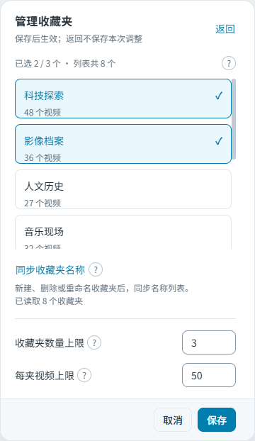

# B 站时光机

**给 B 站设置一个截止时间，让晚于它的内容暂时退场。**

按发布时间过滤当前 B 站页面中的视频、评论和 XML 弹幕，保留原生页面样式。支持 Tampermonkey 用户脚本和 Chrome 扩展，两种安装方式共用同一套过滤核心。

[English](README.en.md) · [安装脚本](https://greasyfork.org/zh-CN/scripts/601594-b-%E7%AB%99%E6%97%B6%E5%85%89%E6%9C%BA) · [下载扩展](https://github.com/LeKZzzz/bilibili-time-machine/releases) · [反馈问题](https://github.com/LeKZzzz/bilibili-time-machine/issues)

> 这是时间过滤工具，不是网页存档。它只筛选当前仍能获取的内容，不能恢复历史首页、已删除视频或当年的推荐排序。时间恰好等于截止时间、晚于截止时间或无法确认时间的内容都会隐藏。

## 界面预览

| 时间过滤与首页补位 | 管理收藏夹 | 查看兴趣标签 |
| --- | --- | --- |
|  |  |  |

截图来自 `v0.2.1` 源码，收藏夹与标签为示例数据，不含真实账号信息。本文介绍当前源码；已安装版本的功能以对应发布版本为准。

## 功能

- **按时间浏览**：过滤视频卡片与封面、已加载的评论及楼中楼，以及 XML 弹幕。
- **搜索结果补齐**：当前页可见结果不足半页时，最多补取后两页并去重，完成后恢复原页码与 URL。
- **收藏偏好补充首页**：从选定收藏夹提取兴趣标签，寻找符合截止时间的视频，填补被隐藏的首页卡片，不打乱已有可见内容。
- **让时间继续走**：截止时间可按真实经过的完整分钟自动推进，刷新页面后继续。
- **随时暂停**：通过页面内的设置面板调整时间、暂停过滤或管理收藏来源。
- **动画时光机与公益广告**：独立片单按作品轮播或顺播；动画可中途插播公益短片，普通观看可选择仅在片尾插播。自 `v0.3.0` 起提供。

时间过滤支持首页、视频详情、分区、搜索、空间视频列表及动态页面。页面范围限于 `www.bilibili.com`、`search.bilibili.com`、`space.bilibili.com` 和 `t.bilibili.com`；独立播放另接入 `www.bilibili.com` 的视频与番剧播放页，不代表完整支持番剧页面过滤。其他未知路由只保留设置入口。

**导航：** [安装](#安装) · [使用](#使用) · [数据与缓存](#数据与缓存) · [常见问题与限制](#常见问题与限制) · [参与开发](#参与开发)

## 安装

扩展与用户脚本**任选其一**，避免在同一页面重复运行。普通使用无需安装 Node.js 或构建源码。

### 用户脚本（推荐）

1. 在浏览器中安装并启用 [Tampermonkey](https://www.tampermonkey.net/)。
2. 打开 [Greasy Fork：B 站时光机](https://greasyfork.org/zh-CN/scripts/601594-b-%E7%AB%99%E6%97%B6%E5%85%89%E6%9C%BA)，点击“安装此脚本”，在 Tampermonkey 中确认安装。
3. 刷新 B 站页面，点击“时光机”开始设置。

更新时，在 Tampermonkey 中检查更新，或从 Greasy Fork 安装新版。Greasy Fork 是用户脚本的正式安装入口，与 GitHub Release 独立发布，两边版本可能不同。

### Chrome 扩展

1. 打开 [GitHub Releases](https://github.com/LeKZzzz/bilibili-time-machine/releases)，在目标版本的 **Assets** 中下载 `bilibili-time-machine-extension-vX.Y.Z.zip` 并解压。
2. 打开 `chrome://extensions`，启用“开发者模式”。
3. 点击“加载已解压的扩展程序”，选择**直接包含 `manifest.json`** 的解压目录。
4. 刷新 B 站页面。

Chrome 不能直接加载 ZIP；Release 中自动生成的 **Source code** 压缩包也不是安装包。升级时解压新版并加载，在扩展管理页确认使用的版本，再刷新 B 站。

<details>
<summary>其他下载方式：Release 用户脚本与 Actions 构建</summary>

Release 还提供 `bilibili-time-machine.user.js` 和 `bilibili-time-machine-userscript-vX.Y.Z.zip`。两者包含相同的生产脚本，ZIP 需先解压，再导入 Tampermonkey；也可在脚本编辑器中替换默认模板并保存。

自动发布会先构建并上传附件，再公开 Release；未看到新版本时请检查对应的 Actions 运行结果。

想试用某个分支的构建，可登录 GitHub，在 [Actions](https://github.com/LeKZzzz/bilibili-time-machine/actions) 中打开该分支成功的 **Build** 运行，下载 **Artifacts**：

| Artifact | 用途 |
| --- | --- |
| `bilibili-time-machine-release` | 生产构建，不含项目诊断日志 |
| `bilibili-time-machine-dev` | 开发构建，包含本地脱敏日志 |

解压后，Chrome 加载其中的 `extension/`，Tampermonkey 使用 `userscript/bilibili-time-machine.user.js`。Actions 构建不等于正式 Release，也不会同步发布到 Greasy Fork。

</details>

## 使用

### 设置截止时间

1. 点击 B 站页面中的“时光机”。
2. 输入**本地时区**的日期和时间，点击“应用时间”（或按 Enter）。
3. 点击“开启过滤”。需要恢复完整页面时，暂停过滤并刷新页面。

例如，设为 `2020-01-01 00:00:00` 后，只有时间**严格早于**这一时刻的内容可以展示。视频按发布时间、评论和弹幕按发送时间判断。

| 操作 | 说明 |
| --- | --- |
| 编辑日期或时间 | 精确到秒；点击“应用时间”才生效，“取消”恢复已生效的值 |
| “填入当前时间” | 只填写当前时、分、秒，保留已选日期；仍需应用 |
| “现在” | 同时填写当前日期和时间；仍需应用 |
| 自动推进 | 按完整分钟推进截止时间，不覆盖正在编辑的草稿；应用新时间后重新计时 |
| “暂停过滤” | 停止过滤；已从响应中移除的内容需要刷新页面才能恢复 |

高级设置中的补请求预算用于确认已出现视频的发布时间：默认每次页面或路由最多补取 20 个视频，可设为 0–100，并发上限为 3。预算耗尽或请求失败后仍无法确认时间的内容会继续隐藏。

### 用收藏偏好填补首页

这项功能默认关闭，只填充首页因时间过滤产生的空位。使用时需要能够访问自己的 B 站收藏夹。

1. 开启“收藏偏好补充首页”，首次开启时选择收藏夹。
2. 在“选择收藏夹”中调整来源和读取上限，点击“保存”，建立收藏偏好。
3. 返回首页查看补位结果。仍有空位时，点击“继续寻找”，或向下滚动后停稳，启动下一轮寻找。
4. 收藏内容变化后，点击“更新收藏偏好”；通过“查看兴趣标签”查看当前提取的标签。

默认最多选择 **3 个收藏夹，每夹读取 50 条**，可调整为 1–10 个收藏夹、每夹 1–200 条。选择超过上限时需先调整才能保存；取消、返回、收起面板或按 Escape 会放弃未保存的修改。

候选按标签偏好随机选择，并做去重；每轮最多搜索 5 次。没有符合时间条件的候选时仍会留空，不会放宽截止时间，也不会替换已经显示的视频。

“同步收藏夹名称”只刷新新建、删除或重命名后的收藏夹列表，不更新视频标签。暂停过滤或处于非首页时，仍可单独更新已选来源的收藏偏好。关闭补位会停止任务并保留缓存与选择；仅收起面板不会取消已经提交的任务。

### 动画时光机与公益广告

打开“时光机”中的动画播放入口，进入“童年放映室”。不需要开启时间过滤或设置截止时间，播放设置也不会改变过滤配置。动画当前主条目不按上传时间过滤，推荐和评论仍沿用原过滤设置。

1. 默认片单包含《猪猪侠之魔幻猪猡纪》《开心超人》各两个已核实条目；可以添加作品，再加入指定视频、分 P 或番剧 `ep` 链接，也可以删除条目。不会自动搜索或展开整季。
2. 选择轮播（每部各播一集）或顺播（先看完一部），保存设置后点击“从头播放”。整份片单播完后循环，短片单会等待其他作品。
3. 动画广告默认开启，启动前会显示提示；普通观看广告默认关闭。两者共用广告片单与间隔，默认 20 分钟，但分别计算实际播放时间，不计暂停、缓冲、拖动和广告时间，倍速不会加快计时。
4. 动画到点暂停插播；普通观看到点只等待片尾，不积攒多条广告。广告加载时即可跳过，结束或跳过后清理覆盖层，再恢复动画或交还原生连播；原本设置“播完暂停”时不会强行播放下一条。
5. “暂停”暂停本次播放，“退出连播”保存进度。刷新、重新打开和新标签页不会自动启动动画；点击“继续观看”恢复。主动离开当前条目会结束连播，修改动画片单或顺序前需先退出。

自动播放被拒绝或起播定位冲突时，使用“点击继续播放”；短暂缓冲、暂停和浏览器阻止播放不算片源失效。明确仅可试看、无完整权限或失效的动画会跳过，整份片单都不可用时停止。不会绕过会员或地区限制。广告使用同源完整 B 站视频页，加载开销和播放器改版会影响可用性；加载失败会撤罩，不连续补播。跨文档切集不保证保留全屏，广告在当前文档内原地覆盖。

2026-10-27 的真实 Chrome MV3 回归已覆盖普通动画自动切集、从头／非零续播，以及会员番剧的调度、续播和广告恢复；不代表全部会员来源、页面变体或油猴流程均通过。油猴剩余组合、当前会员原生全屏和连续缓冲等仍有验证缺口。本地构建不等于 GitHub 或 Greasy Fork 已更新。

## 数据与缓存

播放配置、片单和续播进度分别由用户脚本的 GM 存储或扩展的 `chrome.storage.local` 保存，不与时间过滤配置共用存储项，也不在两种安装方式之间自动同步。系统切集先保存再导航；运行时定期保存位置，关闭页面时也尝试保存。浏览器强制终止可能丢失最后尚未写入的几秒。

收藏夹名称保存在当前 B 站站点的 `localStorage` 中，收藏标签、搜索候选与补位历史保存在本地 `IndexedDB` 中，均按 B 站 UID 区分账号。相关请求用于读取收藏、查询视频信息与搜索候选。

| 缓存 | 有效期 | 每账号上限 |
| --- | --- | --- |
| 收藏标签快照 | 24 小时 | 100 个评分标签 |
| 搜索候选 | 7 天 | 500 条 |
| 已补位视频历史 | 30 天 | 1000 条 |

- 缓存可在同源页面间跨刷新、标签页和路由复用，不同 B 站子域名不共享。
- 标签快照在读取时检查有效期，过期后重建，没有独立的后台定时刷新任务。
- 未开启补位或未选择收藏夹时，不读取收藏内容、不发起标签搜索。
- 去重历史会过期，不保证永久不重复。缺少 IndexedDB API 时，相关缓存仅保留在当前页面内存中。
- 开发构建的脱敏诊断日志只输出到当前浏览器控制台，不上传；不包含响应正文、评论文本、Cookie 或完整 URL。生产构建不包含项目诊断日志。

## 常见问题与限制

| 问题 | 处理方式 |
| --- | --- |
| 找不到“时光机”入口 | 确认扩展或脚本已启用，当前页面属于支持范围；重新加载扩展后还需刷新页面 |
| 首页没有补位 | 确认位于 `www.bilibili.com/`，过滤与补位都已开启、已选择收藏夹，且存在被隐藏的卡片；没有合适候选时会留空 |
| 提示无法验证内容，相关内容已隐藏 | 内容时间未知或补请求失败；可调整高级设置中的补请求预算后重试 |
| 提示收藏标签补位失败 | 根据面板反馈重试“更新收藏偏好”或“继续寻找”；原有时间过滤仍继续工作 |
| 升级后仍是旧界面 | 在扩展管理页重新加载实际使用的扩展目录，再刷新页面；用户脚本请确认已保存新版 |
| 暂停后内容没有全部恢复 | 已过滤的响应数据需要重新获取，请刷新页面 |

**已知边界：** 评论只处理当前已加载的范围，不自动翻完全部历史评论；protobuf 分段弹幕尚未支持。所有无限滚动批次及部分 B 站页面变体仍需进一步验证，不能保证全站内容均被覆盖。

## 参与开发

欢迎提交兼容性问题、文档改进和代码修复。报告问题前请先搜索 [Issues](https://github.com/LeKZzzz/bilibili-time-machine/issues)，并提供安装版本、浏览器版本、安装方式、页面类型、复现步骤与脱敏错误信息。请勿附上 Cookie、凭据或个人账号数据。

### 从源码构建

准备 **Node.js 22**（与 CI 一致）、npm 和 Git：

```sh
git clone https://github.com/LeKZzzz/bilibili-time-machine.git
cd bilibili-time-machine
npm ci
npm run build
```

`npm run build` 先执行类型检查和全部测试，再生成两种生产产物：

| 产物 | 本地安装 |
| --- | --- |
| `dist/extension/` | 在 Chrome 中“加载已解压的扩展程序” |
| `dist/userscript/bilibili-time-machine.user.js` | 导入 Tampermonkey，或替换脚本编辑器中的内容并保存 |

公开 `main` 分支不附带预构建的 `dist/`。重新构建后，扩展需重新加载，用户脚本需重新导入或替换保存，然后刷新 B 站。

### 开发与验证

提交 Pull Request 时，请说明改动内容与验证结果。

```sh
npm ci
npm run typecheck
npm test -- --run
npm run build
npm run build:dev
```

提交前运行上述四项检查与构建命令。开发产物位于 `dist/dev/extension/` 和 `dist/dev/userscript/`，安装方式与生产版相同，控制台日志带有 `[时光机]` 前缀。请勿同时启用生产版与开发版。

项目使用 TypeScript、Vite、Vitest 和 jsdom；原生 TypeScript 设置面板使用 Tailwind CSS 与 daisyUI 编译样式，并注入 Shadow DOM，不依赖 CDN。

| 目录 | 职责 |
| --- | --- |
| `src/core/` | 时间判定、标签评分、候选选择与存储 |
| `src/page/` | 页面响应过滤与首屏状态处理 |
| `src/runtime/` | 扩展与用户脚本适配、消息桥、页面生命周期 |
| `src/playback/` | 动画片单、播放会话、公益广告、播放器与持久化桥接 |
| `src/routes/`、`src/ui/` | 路由支持、设置面板与提示 |
| `extension/`、`userscript/` | 扩展清单与用户脚本入口 |
| `tests/` | 固定样本、单元测试与集成测试 |

<details>
<summary>维护者：自动构建与发布流程</summary>

`.github/workflows/build.yml` 在 push 或手动触发时，执行 `npm ci`、`npm run build` 和 `npm run build:dev`，上传生产与开发 Artifacts，不创建 Release。

正式发布步骤：

1. 完成验证，将 `package.json`、`package-lock.json` 的根包版本、`extension/manifest.json` 和 `vite.config.ts` 中的油猴版本统一为 `X.Y.Z`。
2. 将公开改动推送到 `main`。`.github/workflows/release.yml` 自动读取包版本：对应 `vX.Y.Z` 已发布则跳过，否则构建、检查版本一致性、创建标签与 Release 草稿，上传三份生产附件后自动公开。首次启用也会发布当前尚未发布的版本，无需再改一次版本号。
3. 检查 Actions 结果，下载扩展 ZIP、用户脚本 ZIP、独立 `.user.js` 并验证安装。失败后可重跑，或在 Actions 中选择 `main` 手动运行 Release 工作流；无需手动创建标签或 Release，仅推送标签不触发发布。

Release 工作流使用内置 `GITHUB_TOKEN`，无需 PAT，不上传开发构建，不发布商店或签名 CRX，也不会同步 Greasy Fork。同版本串行检查，不重复发布。上传失败会保留草稿；重跑复用已有标签的源码，通过 `gh release upload --clobber` 补齐附件后公开，不改写标签，也不覆盖已公开版本。

</details>

## 许可证

本项目采用 [MIT 许可证](LICENSE)。
